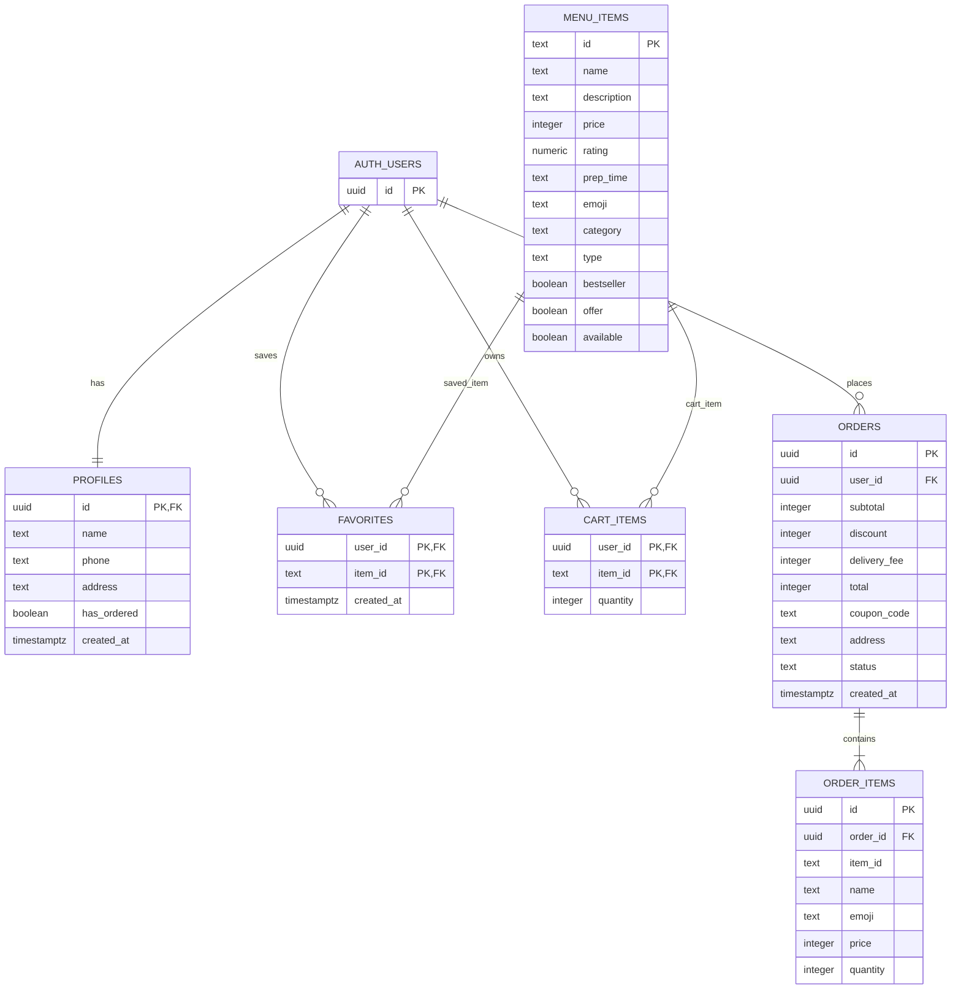

# FoodHub entity relationship diagram

**auth.users** is managed by Supabase Auth. It owns account identity and password handling. Only its id is shown here; FoodHub never stores passwords in its own tables.

**profiles** extends each Auth user with a name, phone, delivery address, and first-order eligibility flag. The signup trigger creates it. Clients may update only name, phone, and address; checkout owns `has_ordered`.

**menu_items** holds the shared catalogue, whole-rupee price, display metadata, dietary type, and availability. Authenticated clients can read it; menu administration is through the database, with no client write grants.

**favorites** is a many-to-many join between users and menu items. Its composite primary key prevents duplicate favorites. Ownership RLS protects each user's saved list.

**cart_items** joins a user to a menu item with a strictly positive quantity. Its composite primary key supports upsert. Reaching zero deletes the row. RLS isolates each cart.

**orders** records a completed checkout's totals, coupon, delivery address, timestamp, and initial `Placed` status. Only the SQL function creates orders. The user can read their own history.

**order_items** stores purchase-time name, emoji, unit price, quantity, and the source item id. `item_id` deliberately has no menu foreign key: removing or editing a catalogue item cannot rewrite a past purchase. Each line belongs to an order; RLS checks that order's owner.

Indexes support order history by user/date, line lookup by order, and cart lookup by user. Composite primary keys also index favorites and carts.
