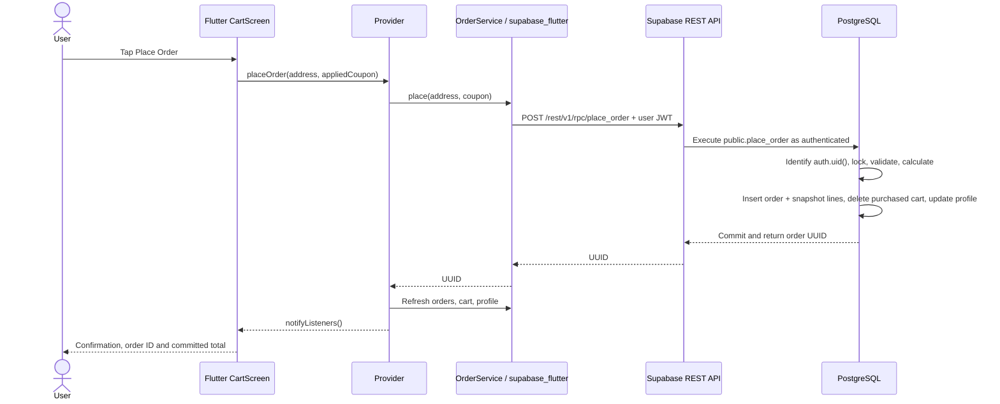

# Place Order request flow

1. Cart quantity and favorite changes use optimistic Provider updates. The corresponding service persists the change through the REST API with the user's JWT. Failure restores the prior local state and displays a readable SnackBar.
2. Every cart change invalidates the old price quote. `CartService` calls `preview_coupon` (even with an empty coupon) so the displayed discount and final total come from SQL. When a coupon was applied, the app re-previews it against the changed cart. Pending requests disable checkout and further cart mutations.
3. `CartScreen` requires a nonempty cart, a nonblank address, and a successful server quote. It calls `OrdersProvider`; screens and providers never access the Supabase client directly.
4. `OrderService` sends `rpc('place_order', params: {'p_address': address, 'p_coupon': coupon})`. Supabase supplies the authenticated JWT to its auto-generated REST API (PostgREST), which executes the database function.
5. The function obtains identity using `auth.uid()`, rather than accepting a client-supplied user id. It requires an address and locks the user's profile so concurrent checkouts cannot reuse first-order eligibility. It locks purchased cart and menu rows to keep snapshots and charged prices consistent. A newly added distinct cart item during checkout is left for the next order.
6. SQL rejects an empty cart or unavailable items. It calculates the subtotal using current database prices and quantities. `coupon_result` trims and uppercases the code, accepts only FOOD50 on a first order, and calculates 50% off capped at ₹150, rounded down to whole rupees. Delivery is free. The final payable total is subtotal minus the SQL discount.
7. SQL inserts one `orders` row, copies name/emoji/price/quantity into `order_items`, removes purchased cart rows, marks `has_ordered=true`, and saves the address. It returns the order UUID. All operations are one transaction: any exception rolls back everything, so a failure cannot clear a cart without creating an order.
8. Provider clears purchased local cart state and reloads orders with nested lines, the profile, and the cart. The UI confirms the short UUID and the committed order total. A refresh failure is shown as a refresh problem; it must not turn a successful checkout into a second order attempt.

## Row Level Security

RLS evaluates each SQL row against policies that use `auth.uid()` from the verified JWT. Shared menu reads are allowed for signed-in users. Profile, favorite, cart, and order reads are limited to their owner; order-line reads additionally check the parent order. Clients have no order-write permissions and cannot update `has_ordered`, even on their own profile. Table grants and column grants supplement RLS. The public project key is safe in a client because it grants no bypass of these checks. `service_role` must never be included in the app.

## Signup trigger

Supabase Auth creates an `auth.users` row after signup; FoodHub passes name and phone as user metadata. The `on_auth_user_created` trigger calls `handle_new_user`, which creates a profile with the same UUID. It runs as a restricted-entry security-definer function with a fixed search path; clients cannot invoke it directly or insert arbitrary profiles. Missing names default to an empty string. The schema also backfills profiles when installed into a project with existing accounts.

## place_order

`place_order` is a security-definer function with `search_path = public`, explicitly callable only by authenticated users. Because the function executes with its owner's privileges, it performs its own identity check and restricts every cart/profile operation to that identity. SQL owns coupon eligibility, pricing, totals, and all checkout writes so a modified Flutter client cannot forge a discount or paid price. A per-user profile lock serializes checkout and `order_items` snapshots preserve purchase history. Exceptions abort the transaction; the app surfaces only deliberate business-rule exceptions, with generic friendly messages for infrastructure failures.
